<!-- Generated with Readmefy. Edit .readme/config.json or regenerate it from the web. -->

<picture><source media="(prefers-color-scheme: dark)" srcset="assets/header-nnc82v-dark.svg"></picture>

<a href="https://api.github.com/repos/Plipps45/Ripple"><picture><source media="(prefers-color-scheme: dark)" srcset="assets/projects-bkmpg-ripple-dark.svg"></picture></a>

<picture><source media="(prefers-color-scheme: dark)" srcset="assets/divider-nnc830-dark.svg"></picture>

<a href="https://discord.com/"><picture><source media="(prefers-color-scheme: dark)" srcset="assets/socials-nnc832-1-dark.svg"></picture></a>&nbsp;<a href="https://buymeacoffee.com/plipps"><picture><source media="(prefers-color-scheme: dark)" srcset="assets/socials-nnc832-2-dark.svg"></picture></a>

<picture><source media="(prefers-color-scheme: dark)" srcset="assets/stack-ve4jh-dark.svg"></picture>

<picture><source media="(prefers-color-scheme: dark)" srcset="assets/calendar-nka0i-dark.svg"></picture>

